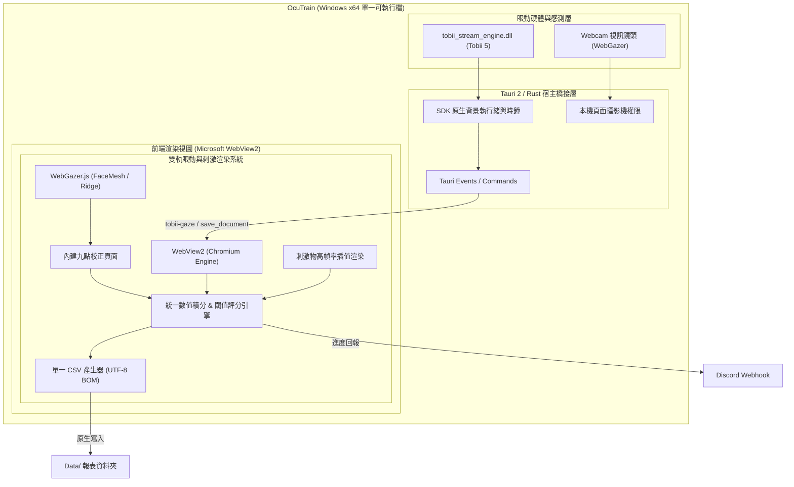

# 基於 Tobii Eye Tracker 5 與 WebGazer 之眼動復能訓練系統
## 產品需求規格說明書 (PRD) 與 技術規格架構說明書 (TRD)

---

| 文件屬性 | 規格說明 |
| :--- | :--- |
| **文件版本** | v1.3.0 (WebGazer 精度驗證頁面、跨測驗通用校正與 UI 風格標準化版) |
| **研究員角色** | 資深心理學與認知神經科學研究者 / 系統架構師 |
| **硬體與資料源** | 1. **Tobii Eye Tracker 5** (原生 C API 串流，專用紅外線感測器) 2. **WebGazer.js** (視訊鏡頭機器學習，依推論速度取樣，支援內建九點校正與五點精度驗證) |
| **交付目標** | 單一可直接執行之免安裝綠色程式 (`.exe`)，隨插即用 |
| **設計基準** | 嚴格繼承 [`眼動訓練.html`](file:///C:/Users/ian/Desktop/視覺復能program/眼動訓練.html) 之視覺風格、UI 與互動邏輯 |
| **專案子資料夾** | `C:\Users\ian\Desktop\視覺復能program\TobiiOculomotor\` |

---

## 目錄
1. [研究背景與核心目標](#1-研究背景與核心目標)
2. [實驗設計與臨床參數規範](#2-實驗設計與臨床參數規範)
   - 2.1 參數分工：全域參數 vs 遊戲特定參數
   - 2.2 距離閾值：純視角單位 (度/角分)
   - 2.3 眨眼與失焦過濾：分母完全剔除 (Tobii 與 WebGazer 一致)
   - 2.4 階層跳視 (Saccade) 200ms 生理潛伏期補償窗
   - 2.5 商業防護與通訊：保留 30 天鎖死與 Discord Webhook
3. [雙眼動追蹤引擎規格、校正與驗證流程](#3-雙眼動追蹤引擎規格校正與驗證流程)
   - 3.1 Tobii Eye Tracker 5 模式 (SDK 原生串流)
   - 3.2 WebGazer 模式 (九點校正與五點精度驗證)
   - 3.3 全域校正與跨子測驗通用架構 (Cross-Module Calibration Sharing)
   - 3.4 計算方法一致性保障
4. [產品需求規格 (PRD)](#4-產品需求規格-prd)
   - 4.1 使用者體驗與原生風格標準 (移除 Emoji、統一類別)
   - 4.2 精度驗證統計模型 (視角誤差判定)
   - 4.3 距離閾值計分演算法數學模型
   - 4.4 單一 CSV 數據匯出規範
5. [技術規格架構 (TRD)](#5-技術規格架構-trd)
   - 5.1 技術選型決策：Tauri 2 + Rust + WebView2 雙軌眼動架構
   - 5.2 WebView2 攝影機授權與跨進程通訊
   - 5.3 系統整體架構圖
   - 5.4 單一檔案 (.exe) 打包與發佈流程
6. [驗證與品質保證](#6-驗證與品質保證)

---

## 1. 研究背景與核心目標

本系統旨在將既有之 [`眼動訓練.html`](file:///C:/Users/ian/Desktop/視覺復能program/眼動訓練.html) 視覺復能架構，升級為具備**雙軌眼動追蹤引擎**的專業級臨床復能訓練系統：
1. **Tobii Eye Tracker 5 原生模式**：接收 SDK 原生眼動串流，保留來源時間戳進行視線分析。
2. **WebGazer 視訊鏡頭模式**：利用一般電腦 Webcam 進行臉部特徵網格（FaceMesh）與嶺回歸（Ridge Regression）眼動追蹤，並配備**內建九點校正頁面與五點精度驗證 (Validation)**，使無專用硬體的受試者亦能隨時隨地進行復能。

兩大追蹤引擎的**計算方法完全嚴格一致**（視角閾值換算、時間數值積分、眨眼剔除、跳視潛伏期容許、同步數據欄位及 CSV 輸出）。系統封裝為**單一獨立免安裝執行檔 (`OcuTrain_<版本>_x64-portable.exe`)**，隨插即用。

---

## 2. 實驗設計與臨床參數規範

### 2.1 參數分工：全域參數 vs 遊戲特定參數
* **全域參數 (Global Parameters)**：
  - **螢幕物理寬度 ($W_{cm}$)**、**螢幕物理高度 ($H_{cm}$)**、**受試者觀看距離 ($D_{cm}$)**。
  - 於主選單「顯示校準 (Calibration)」設定一次，供所有四大模組共用。
* **遊戲特定參數 (Module-specific Parameters)**：
  - 各模組各自獨立配置：
    - 刺激物大小（單位：角分 arcmin）。
    - 速度（角分/秒）、維持時長（毫秒）、測驗總時間（秒）、測驗模式（Evaluation / Predictable / Random）等。

### 2.2 距離閾值：純視角單位 (度/角分)
* 受試者在不同解析度與不同大小的螢幕上，相同像素所對應的視網膜成像大小完全不同。
* 因此，在標閾值**嚴格以視角（度 / 角分）為核心基準**。
* 實際在標閾值取「設定閾值 + 追蹤器誤差容許」與「五點驗證閾值（平均誤差的兩倍，最低 0.5°）」的較大值；尚無同來源的有效驗證時，使用前者。
  - Tobii Eye Tracker 5 誤差容許為 1°，WebGazer 為 2°；未追蹤模式不加入誤差容許。
  - 驗證已包含量測誤差，因此不再將誤差容許加到驗證閾值上；原始量測誤差保留於 CSV。
* 物理距離換算公式：
  $$\theta_{arcmin} = 2 \times \arctan\left(\frac{S_{cm}}{2 \times D_{cm}}\right) \times \frac{180 \times 60}{\pi}$$

### 2.3 眨眼與失焦過濾：分母完全剔除
* 在所有時序積分中，當眼動儀訊號無效（眨眼、脫離追蹤範圍），該段時長 $T_{blink}$ **嚴格從眼動正確率的分母剔除**。
* 此標準在 Tobii 與 WebGazer 下完全統一。

### 2.4 階層跳視 (Saccade) 200ms 生理潛伏期補償窗
* 跳視模組在目標刺激物躍遷出現後的最初 200ms 內，屬於大腦傳遞神經訊號之生理潛伏期（Saccadic Latency）。
* 此 200ms 區間內之眼動時間不納入分母與分子計算，不扣除正確率。

### 2.5 商業防護與通訊
* 保留原系統之 30 天到期鎖死檢查 (`checkExpiry`)。
* 測驗完成後具備 Discord Webhook 自動通訊報表傳送機制。

### 2.6 Smooth Pursuit 與 Fixation 的計分階段
* **Smooth Pursuit**：圓球以設定速度從中心移動至邊緣，再連續移動回中心；完成往返才計為一個目標。去程與回程均納入 Accuracy，中央十字準備時間排除。
* **Fixation**：僅計算圓球抵達邊緣後的 `hold` 階段；中央十字與移動途中排除。移動軌跡、視線與誤差仍完整保留在原始資料及 CSV。
* 依來源樣本時間對應刺激階段，並限制時間權重不得跨入排除階段。CSV 的 `accuracy_eligible` 表示當下階段是否可計分；`accuracy_delta_t_ms` 為該有效樣本實際計入的時間。
* `is_within_threshold` 表示原始空間距離是否命中，包括未計分的階段；不能直接以此欄樣本比例取代時間加權 Accuracy。

### 2.7 Saccade 的 Time To First Fixation (TFF)
* Accuracy 沿用現有計分及每次目標出現後的 200 ms 潛伏容許窗；TFF 獨立從目標實際出現時間起算，不受此窗限制。
* 必須先偵測眼動，再找首次穩定注視，避免把上一位置延續的注視算成新反應；注視不必落在目標範圍內。
* 以來源時間戳與物理視角計算相鄰樣本角速度，採 I-VT-style 判定：速度不超過 30°/s、至少 3 筆有效樣本且持續至少 100 ms。無效樣本或超過 100 ms 的缺口中斷注視，不插值。
* TFF = 首次確認注視的**開始時間** − 目標出現時間，另記錄確認時間；不將等待確認的 100 ms 加入 TFF。
* 每個目標分別記錄 TFF 與狀態（`detected`、`no_movement_detected`、`no_confirmed_fixation`、`no_valid_samples`）；未偵測者為 N/A，平均值只使用成功偵測的目標，並同時顯示偵測數／總目標數。
* 結果畫面顯示平均 TFF，CSV 包含逐目標結果與樣本注視標記，JSON 包含完整 `tff_analysis`。Tobii 與 WebGazer 共用此計算，不依固定 Hz 換算。
* 此為程式的來源樣本分類器，並非 Tobii SDK 的內建注視事件；角速度及持續時間採用 [Tobii I-VT 參考設定](https://developer.tobii.com/xr/ocumen/ocumen-filters/ocumen_filters/fixation_tobii_ivt/)，未套用其全部合併／插值流程。WebGazer 雜訊可能影響偵測率，須以實機資料確認。

---

## 3. 雙眼動追蹤引擎規格、校正與驗證流程

### 3.1 Tobii Eye Tracker 5 模式
* **採樣率**：依 SDK 實際來源時間戳，接收全部原生樣本；不固定重取樣為 33 Hz。透過微秒時間戳記（`device_timestamp_us`）進行時間積分。
* **校正方式**：在 Windows 系統下的「Tobii Experience」官方應用程式完成硬體眼動校正，訓練系統直接繼承其全域視線空間。
* **未連線處理**：未偵測到 USB 硬體時顯示未連線，可改用 WebGazer 或 Off，不產生模擬眼動資料。

### 3.2 WebGazer 模式：九點校正與五點精度驗證
* **採樣率**：約 30~34 Hz（由攝影機訊框與 FaceMesh 推論驅動）。
* **內建完整流程**：
  1. **臉部居中確認 (`OptionalWebGazerCameraPlugin`)**：  
     若攝影機尚未啟動，開啟鏡頭預覽視窗自動偵測臉部。
  2. **九點點擊校正 (`jsPsychWebgazerCalibrate`)**：  
     螢幕依序出現 9 個校正點（10%、50%、90% 矩陣），受試者每點點擊 2 次，擬合嶺回歸模型。
  3. **五點精度驗證 (`WebGazerValidationPlugin`)**：  
     校正完成後立即進入驗證流程。中央與四個象限依序呈現 5 個驗證標靶（[50,50], [20,20], [80,20], [20,80], [80,80]），每點停留 1400ms（前 350ms 跳視過渡窗、後 1050ms 穩定取樣窗），即時統計視角偏差度數。
  4. **驗證結果評估**：
     - 若平均視角誤差 $\le 3.5^\circ$：判定為「通過」，子測驗自動進入倒數開始，主選單校正按鈕更新狀態為已就緒。
     - 若平均視角誤差 $> 3.5^\circ$：判定為「未通過」，系統明確提示重校建議，提供「重新九點校正」與「略過並繼續」兩種彈性操作。

### 3.3 全域校正與跨子測驗通用架構 (Cross-Module Sharing)
* **一次校正，全域通用**：主選單完成「WebGazer 校正」或任一子測驗完成校正後，模型權重保留於全域記憶體中。
* **子測驗免重複九點校正**：後續各子測驗（跳視、平滑追隨、前庭動眼、注視）啟動時，**自動跳過九點校正**，僅需執行極速的五點精度驗證。
* **失效重校防護**：只有當驗證未通過或視窗解析度發生非預期更動時，才觸發重新校正循環。

### 3.4 計算方法一致性保障
無論使用者選擇 **Tobii** 還是 **WebGazer**，底層評分計算邏輯完全相同：
- 同樣的歐氏距離視角換算。
- 同樣的時序黎曼積分 ($\Delta t_k = t_k - t_{k-1}$，異常值限制於 100ms 內)。
- 同樣的眨眼扣除分母機制。
- 同樣的 200ms 跳視潛伏容許窗。
- 同樣的同步時序欄位、模組階段規則、TFF 分類及單一 CSV 輸出。

---

## 4. 產品需求規格 (PRD)

### 4.1 使用者體驗與原生風格標準
* **免安裝單檔**：直接雙擊 `OcuTrain_<版本>_x64-portable.exe` 即可使用。
* **UI 設計系統標準化 (Zero Emoji)**：
  - 嚴格遵守原生專業風格，移除所有按鈕文字中的 Emoji（例如移除 📁 與 📸）。
  - 「開啟報表資料夾」按鈕標準化為 `ghost-button` 樣式。
  - 「WebGazer 校正」按鈕標準化為 `secondary-button` 樣式。
* **資料來源彈性切換**：可於顯示校準或主選單中隨時切換「Tobii Eye Tracker 5」、「WebGazer」或「Off」。

### 4.2 精度驗證統計模型
對驗證標靶點 $i$ ($i \in \{1..5\}$)，其螢幕物理座標為 $(T_{x,i}, T_{y,i})$，取樣窗內之中位數視線預測點為 $(M_{x,i}, M_{y,i})$：
1. **點位物理誤差**：
   $$\Delta X_{cm} = |M_{x,i} - T_{x,i}| \cdot \frac{W_{cm}}{W_{px}}, \quad \Delta Y_{cm} = |M_{y,i} - T_{y,i}| \cdot \frac{H_{cm}}{H_{px}}$$
   $$D_{cm,i} = \sqrt{\Delta X_{cm}^2 + \Delta Y_{cm}^2}$$
2. **點位視角誤差**：
   $$\theta_{deg,i} = 2 \times \arctan\left(\frac{D_{cm,i}}{2 \times D_{cm}}\right) \times \frac{180}{\pi}$$
3. **整體平均視角誤差與判定**：
   $$\bar{\theta}_{deg} = \frac{1}{N_{valid}} \sum_{i=1}^{N_{valid}} \theta_{deg,i}$$
   $$\text{Status} = \begin{cases} \text{Pass}, & \text{if } \bar{\theta}_{deg} \le 3.5^\circ \\ \text{Fail (Recalibrate recommended)}, & \text{otherwise} \end{cases}$$

### 4.3 距離閾值計分演算法數學模型
1. **瞬間歐氏距離誤差 ($D_t$)**：
   $$D_t = \sqrt{(X_{gaze}(t) - X_{stim}(t))^2 + (Y_{gaze}(t) - Y_{stim}(t))^2}$$
2. **在標判定 ($\mathbb{I}_{hit}(t)$)**：
   $$\mathbb{I}_{hit}(t) = \begin{cases} 1, & \text{if } D_t \le R_{th} \text{ 且 } GazeValid(t) = \text{true} \\ 0, & \text{otherwise} \end{cases}$$
3. **在標時間累計 ($T_{in\_thresh}$)**：
   $$T_{in\_thresh} = \sum_{k=1}^{N} \mathbb{I}_{hit}(t_k) \times \Delta t_{scored,k}$$
4. **有效評估總時間 ($T_{valid}$)**：
   $$T_{valid} = \sum_{k=1}^{N} [GazeValid(t_k) = \text{true}] \times \Delta t_{scored,k}$$
   其中 $\Delta t_{scored,k}$ 為依 2.6 節模組階段與跳視潛伏窗排除後的有效時間權重；分子也使用相同權重。
5. **眼動正確率 (Accuracy Rate, %)**：
   $$Accuracy = \left( \frac{T_{in\_thresh}}{T_{valid}} \right) \times 100\%$$

### 4.3 單一 CSV 數據匯出規範
自動儲存至程式所在目錄之 `Data/` 資料夾：  
`{受試者ID}_{測驗日期8碼}_{測驗時間6碼}_{模組代碼}_{眼動儀類型}_眼動記錄.csv`

#### 包含項目：
1. **中繼資料區塊 (Metadata Headers，以 `#` 起頭)**：包含受試者 ID、測驗代碼、螢幕物理尺寸、觀看距離、刺激球大小、移動速度、距離閾值、測驗總時長、有效注視時長、生理眨眼時長、低於閾值在標時長、眼動正確率、設備型號（Tobii 5 或 WebGazer）、取樣頻率。
2. **同步時序數據表 (25 個欄位)**：
   - `採樣序號`、`自測驗開始毫秒 (ms)`、`設備微秒時間戳記 (us)`、`採樣間隔 (ms)`、`瞬間頻率 (Hz)`
   - `注視有效性 (1/0)`、`注視點X (px)`、`注視點Y (px)`
   - `刺激物X (px)`、`刺激物Y (px)`
   - `瞬間距離誤差 (px)`、`瞬間距離誤差 (deg)`、`是否在閾值內 (1/0)`
   - `測驗階段`、`方位名稱`
   - `browser_received_trial_time_ms`、`transport_delay_ms`、`stimulus_frame_time_ms`、`clock_mapping`
   - `target_number`、`accuracy_eligible`、`accuracy_delta_t_ms`
   - `gaze_velocity_deg_s`、`is_fixation`、`tff_ms`（非 Saccade 測驗留空）
3. **UTF-8 with BOM 編碼**：Excel 開啟直接正常顯示繁體中文。

---

## 5. 技術規格架構 (TRD)

### 5.1 技術選型決策：Tauri 2 + Rust + WebView2 雙軌眼動架構
* **桌面宿主**：Tauri 2 + Rust，使用 Windows 系統 Microsoft Edge WebView2，不攜帶 .NET 或 Chromium 執行環境。
  - 依視窗所在螢幕、視窗內容區域的實體位置與尺寸更新眼動座標；不指定固定螢幕、解析度或縮放比例。Tobii Experience 必須校正在同一螢幕上。
* **WebGazer 初始化與取樣**：FaceMesh 與 BlazeFace 模型、權重隨 EXE 內嵌，透過 Tauri 本機資源協定讀取，校正無須從模型伺服器下載；jsPsych 直接接收 WebGazer 的單一預測串流，避免驗證與訓練同時重複執行臉部推論。
  - 模型來源：[FaceMesh v1](https://tfhub.dev/mediapipe/tfjs-model/facemesh/1/default/1)、[BlazeFace v1](https://tfhub.dev/tensorflow/tfjs-model/blazeface/1/default/1)。
  - WebGazer 保留推論開始時的單調時間戳 `sample_performance_ms`，以此配對刺激歷史畫面；jsPsych 的測驗相對時間 `t` 與結果送達時間不作為來源時間。
  - CSV 的 `transport_delay_ms` 在 WebGazer 模式表示「推論開始至回呼送達」的耗時，未包含鏡頭曝光／擷取及濾波延遲；來源時間不可用時回退為回呼時間，延遲留空。這不是鏡頭至螢幕的完整延遲量測。
* **通訊機制**：
  - Tobii 訊號：Rust 背景執行緒調用 `tobii_stream_engine.dll`，透過 Tauri 的 `tobii-gaze`、`tobii-status` 事件傳送至前端；保留全部原生樣本與 SDK 時間戳，不固定重取樣。
  - 時鐘：原生執行緒序列處理 SDK clock 請求，前端五次探測取最低往返時間，以中點估算 SDK clock 與 `performance.now()` 的偏移，並記錄往返時間一半的估計不確定性。每 30 秒呼叫 SDK timesync。
  - WebGazer 訊號：前端 WebGazer.js 透過 `jsPsychExtensionWebgazer.onGazeUpdate` 直接推送，全流程無須經由網路協定。
  - 存檔橋接：透過 Tauri `save_document` 命令非同步寫入 EXE 旁 `Data/`，只允許 CSV／JSON 檔名；CSV 使用 UTF-8 BOM，失敗時顯示錯誤並保留工作階段供重試。

### 5.2 WebView2 攝影機授權
Rust 宿主只自動授予主視窗 `https://tauri.localhost` 本機頁面的相機請求；其他來源沿用系統預設權限。Windows 的相機隱私設定仍需允許桌面程式存取。

### 5.3 系統整體架構圖

---

## 6. 驗證與品質保證

1. **單檔可攜性**：`OcuTrain_<版本>_x64-portable.exe` 內嵌原生 DLL 與所有網頁／模型資源；僅 DLL 需快取至使用者應用程式資料夾。
2. **取樣波動容錯性**：依來源時間戳處理不同採樣頻率的間隔、抖動與缺口；超過 100 ms 的缺口不當作整段有效注視。
3. **無硬體相容**：無 Tobii 專用硬體時顯示未連線，可改用 WebGazer 或 Off，不以模擬資料替代實際眼動；無網路時間時沿用既有本機時鐘檢查。
