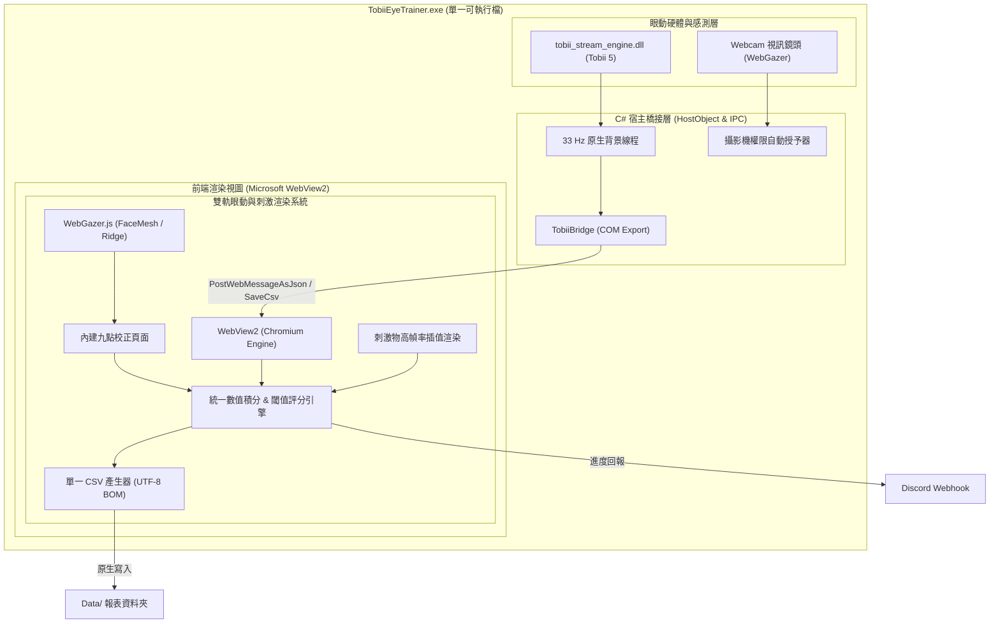

# 基於 Tobii Eye Tracker 5 與 WebGazer 之眼動復能訓練系統
## 產品需求規格說明書 (PRD) 與 技術規格架構說明書 (TRD)

---

| 文件屬性 | 規格說明 |
| :--- | :--- |
| **文件版本** | v1.3.0 (WebGazer 精度驗證頁面、跨測驗通用校正與 UI 風格標準化版) |
| **研究員角色** | 資深心理學與認知神經科學研究者 / 系統架構師 |
| **硬體與資料源** | 1. **Tobii Eye Tracker 5** (原生 C API，33 Hz，專用紅外線感測器)<br>2. **WebGazer.js** (視訊鏡頭機器學習，~30 Hz，支援內建九點校正與五點精度驗證) |
| **交付目標** | 單一可直接執行之免安裝綠色程式 (`.exe`)，隨插即用 |
| **設計基準** | 嚴格繼承 [`眼動訓練.html`](file:///C:/Users/ian/Desktop/視覺復能program/眼動訓練.html) 之視覺風格、UI 與互動邏輯 |
| **專案子資料夾** | `C:\Users\ian\Desktop\視覺復能program\TobiiOculomotor\` |

---

## 目錄
1. [研究背景與核心目標](#1-研究背景與核心目標)
2. [實驗設計與臨床參數規範](#2-實驗設計與臨床參數規範)
   - 2.1 參數分工：全域參數 vs 遊戲特定參數
   - 2.2 距離閾值：純視角單位 (度/角分)
   - 2.3 眨眼與失焦過濾：分母完全剔除 (Tobii 與 WebGazer 一致)
   - 2.4 階層跳視 (Saccade) 200ms 生理潛伏期補償窗
   - 2.5 商業防護與通訊：保留 30 天鎖死與 Discord Webhook
3. [雙眼動追蹤引擎規格、校正與驗證流程](#3-雙眼動追蹤引擎規格校正與驗證流程)
   - 3.1 Tobii Eye Tracker 5 模式 (33 Hz 原生串流)
   - 3.2 WebGazer 模式 (九點校正與五點精度驗證)
   - 3.3 全域校正與跨子測驗通用架構 (Cross-Module Calibration Sharing)
   - 3.4 計算方法一致性保障
4. [產品需求規格 (PRD)](#4-產品需求規格-prd)
   - 4.1 使用者體驗與原生風格標準 (移除 Emoji、統一類別)
   - 4.2 精度驗證統計模型 (視角誤差判定)
   - 4.3 距離閾值計分演算法數學模型
   - 4.4 單一 CSV 數據匯出規範
5. [技術規格架構 (TRD)](#5-技術規格架構-trd)
   - 5.1 技術選型決策：.NET 10 + WebView2 + 原生驅動與 WebGazer 雙軌
   - 5.2 WebView2 攝影機授權與跨進程通訊
   - 5.3 系統整體架構圖
   - 5.4 單一檔案 (.exe) 打包與發佈流程
6. [驗證與品質保證](#6-驗證與品質保證)

---

## 1. 研究背景與核心目標

本系統旨在將既有之 [`眼動訓練.html`](file:///C:/Users/ian/Desktop/視覺復能program/眼動訓練.html) 視覺復能架構，升級為具備**雙軌眼動追蹤引擎**的專業級臨床復能訓練系統：
1. **Tobii Eye Tracker 5 原生模式**：以無損 33 Hz 專用眼動儀提供極高精度的視線分析。
2. **WebGazer 視訊鏡頭模式**：利用一般電腦 Webcam 進行臉部特徵網格（FaceMesh）與嶺回歸（Ridge Regression）眼動追蹤，並配備**內建九點校正頁面與五點精度驗證 (Validation)**，使無專用硬體的受試者亦能隨時隨地進行復能。

兩大追蹤引擎的**計算方法完全嚴格一致**（視角閾值換算、時間數值積分、眨眼剔除、跳視潛伏期容許、同步數據欄位及 CSV 輸出）。系統封裝為**單一獨立免安裝執行檔 (`TobiiEyeTrainer.exe`)**，隨插即用。

---

## 2. 實驗設計與臨床參數規範

### 2.1 參數分工：全域參數 vs 遊戲特定參數
* **全域參數 (Global Parameters)**：
  - **螢幕物理寬度 ($W_{cm}$)**、**螢幕物理高度 ($H_{cm}$)**、**受試者觀看距離 ($D_{cm}$)**。
  - 於主選單「顯示校準 (Calibration)」設定一次，供所有四大模組共用。
* **遊戲特定參數 (Module-specific Parameters)**：
  - 各模組各自獨立配置：
    - 刺激物大小（單位：角分 arcmin）。
    - 速度（角分/秒）、維持時長（毫秒）、測驗總時間（秒）、測驗模式（Evaluation / Predictable / Random）等。

### 2.2 距離閾值：純視角單位 (度/角分)
* 受試者在不同解析度與不同大小的螢幕上，相同像素所對應的視網膜成像大小完全不同。
* 因此，在標閾值**嚴格以視角（度 / 角分）為核心基準**。
* 物理距離換算公式：
  $$\theta_{arcmin} = 2 \times \arctan\left(\frac{S_{cm}}{2 \times D_{cm}}\right) \times \frac{180 \times 60}{\pi}$$

### 2.3 眨眼與失焦過濾：分母完全剔除
* 在所有時序積分中，當眼動儀訊號無效（眨眼、脫離追蹤範圍），該段時長 $T_{blink}$ **嚴格從眼動正確率的分母剔除**。
* 此標準在 Tobii 與 WebGazer 下完全統一。

### 2.4 階層跳視 (Saccade) 200ms 生理潛伏期補償窗
* 跳視模組在目標刺激物躍遷出現後的最初 200ms 內，屬於大腦傳遞神經訊號之生理潛伏期（Saccadic Latency）。
* 此 200ms 區間內之眼動時間不納入分母與分子計算，不扣除正確率。

### 2.5 商業防護與通訊
* 保留原系統之 30 天到期鎖死檢查 (`checkExpiry`)。
* 測驗完成後具備 Discord Webhook 自動通訊報表傳送機制。

---

## 3. 雙眼動追蹤引擎規格、校正與驗證流程

### 3.1 Tobii Eye Tracker 5 模式
* **採樣率**：33 Hz 硬體原生採樣，透過微秒時間戳記（`device_timestamp_us`）進行高精度黎曼積分。
* **校正方式**：在 Windows 系統下的「Tobii Experience」官方應用程式完成硬體眼動校正，訓練系統直接繼承其全域視線空間。
* **模擬器備援**：若未偵測到 USB 硬體，自動切換至具備微顫與生理眨眼的 33 Hz 模擬器供離線演示。

### 3.2 WebGazer 模式：九點校正與五點精度驗證
* **採樣率**：約 30~34 Hz（由攝影機訊框與 FaceMesh 推論驅動）。
* **內建完整流程**：
  1. **臉部居中確認 (`OptionalWebGazerCameraPlugin`)**：  
     若攝影機尚未啟動，開啟鏡頭預覽視窗自動偵測臉部。
  2. **九點點擊校正 (`jsPsychWebgazerCalibrate`)**：  
     螢幕依序出現 9 個校正點（10%、50%、90% 矩陣），受試者每點點擊 2 次，擬合嶺回歸模型。
  3. **五點精度驗證 (`WebGazerValidationPlugin`)**：  
     校正完成後立即進入驗證流程。中央與四個象限依序呈現 5 個驗證標靶（[50,50], [20,20], [80,20], [20,80], [80,80]），每點停留 1400ms（前 350ms 跳視過渡窗、後 1050ms 穩定取樣窗），即時統計視角偏差度數。
  4. **驗證結果評估**：
     - 若平均視角誤差 $\le 3.5^\circ$：判定為「通過」，子測驗自動進入倒數開始，主選單校正按鈕更新狀態為已就緒。
     - 若平均視角誤差 $> 3.5^\circ$：判定為「未通過」，系統明確提示重校建議，提供「重新九點校正」與「略過並繼續」兩種彈性操作。

### 3.3 全域校正與跨子測驗通用架構 (Cross-Module Sharing)
* **一次校正，全域通用**：主選單完成「WebGazer 校正」或任一子測驗完成校正後，模型權重保留於全域記憶體中。
* **子測驗免重複九點校正**：後續各子測驗（跳視、平滑追隨、前庭動眼、注視）啟動時，**自動跳過九點校正**，僅需執行極速的五點精度驗證。
* **失效重校防護**：只有當驗證未通過或視窗解析度發生非預期更動時，才觸發重新校正循環。

### 3.4 計算方法一致性保障
無論使用者選擇 **Tobii** 還是 **WebGazer**，底層評分計算邏輯完全相同：
- 同樣的歐氏距離視角換算。
- 同樣的時序黎曼積分 ($\Delta t_k = t_k - t_{k-1}$，異常值限制於 100ms 內)。
- 同樣的眨眼扣除分母機制。
- 同樣的 200ms 跳視潛伏容許窗。
- 同樣的 15 欄位同步時序記錄與單一 CSV 輸出。

---

## 4. 產品需求規格 (PRD)

### 4.1 使用者體驗與原生風格標準
* **免安裝單檔**：直接雙擊 `TobiiEyeTrainer.exe` 即可使用。
* **UI 設計系統標準化 (Zero Emoji)**：
  - 嚴格遵守原生專業風格，移除所有按鈕文字中的 Emoji（例如移除 📁 與 📸）。
  - 「開啟報表資料夾」按鈕標準化為 `ghost-button` 樣式。
  - 「WebGazer 校正」按鈕標準化為 `secondary-button` 樣式。
* **資料來源彈性切換**：可於顯示校準或主選單中隨時切換「Tobii Eye Tracker 5」、「WebGazer」或「Off」。

### 4.2 精度驗證統計模型
對驗證標靶點 $i$ ($i \in \{1..5\}$)，其螢幕物理座標為 $(T_{x,i}, T_{y,i})$，取樣窗內之中位數視線預測點為 $(M_{x,i}, M_{y,i})$：
1. **點位物理誤差**：
   $$\Delta X_{cm} = |M_{x,i} - T_{x,i}| \cdot \frac{W_{cm}}{W_{px}}, \quad \Delta Y_{cm} = |M_{y,i} - T_{y,i}| \cdot \frac{H_{cm}}{H_{px}}$$
   $$D_{cm,i} = \sqrt{\Delta X_{cm}^2 + \Delta Y_{cm}^2}$$
2. **點位視角誤差**：
   $$\theta_{deg,i} = 2 \times \arctan\left(\frac{D_{cm,i}}{2 \times D_{cm}}\right) \times \frac{180}{\pi}$$
3. **整體平均視角誤差與判定**：
   $$\bar{\theta}_{deg} = \frac{1}{N_{valid}} \sum_{i=1}^{N_{valid}} \theta_{deg,i}$$
   $$\text{Status} = \begin{cases} \text{Pass}, & \text{if } \bar{\theta}_{deg} \le 3.5^\circ \\ \text{Fail (Recalibrate recommended)}, & \text{otherwise} \end{cases}$$

### 4.3 距離閾值計分演算法數學模型
1. **瞬間歐氏距離誤差 ($D_t$)**：
   $$D_t = \sqrt{(X_{gaze}(t) - X_{stim}(t))^2 + (Y_{gaze}(t) - Y_{stim}(t))^2}$$
2. **在標判定 ($\mathbb{I}_{hit}(t)$)**：
   $$\mathbb{I}_{hit}(t) = \begin{cases} 1, & \text{if } D_t \le R_{th} \text{ 且 } GazeValid(t) = \text{true} \text{ 且非潛伏期} \\ 0, & \text{otherwise} \end{cases}$$
3. **在標時間累計 ($T_{in\_thresh}$)**：
   $$T_{in\_thresh} = \sum_{k=1}^{N} \mathbb{I}_{hit}(t_k) \times \Delta t_k$$
4. **有效評估總時間 ($T_{valid}$)**：
   $$T_{valid} = \sum_{k=1}^{N} [GazeValid(t_k) = \text{true} \land \text{Phase} \neq \text{latency}] \times \Delta t_k$$
5. **眼動正確率 (Accuracy Rate, %)**：
   $$Accuracy = \left( \frac{T_{in\_thresh}}{T_{valid}} \right) \times 100\%$$

### 4.3 單一 CSV 數據匯出規範
自動儲存至程式所在目錄之 `Data/` 資料夾：  
`{受試者ID}_{測驗日期8碼}_{測驗時間6碼}_{模組代碼}_{眼動儀類型}_眼動記錄.csv`

#### 包含項目：
1. **中繼資料區塊 (Metadata Headers，以 `#` 起頭)**：包含受試者 ID、測驗代碼、螢幕物理尺寸、觀看距離、刺激球大小、移動速度、距離閾值、測驗總時長、有效注視時長、生理眨眼時長、低於閾值在標時長、眼動正確率、設備型號（Tobii 5 或 WebGazer）、取樣頻率。
2. **同步時序數據表 (15 個欄位)**：
   - `採樣序號`、`自測驗開始毫秒 (ms)`、`設備微秒時間戳記 (us)`、`採樣間隔 (ms)`、`瞬間頻率 (Hz)`
   - `注視有效性 (1/0)`、`注視點X (px)`、`注視點Y (px)`
   - `刺激物X (px)`、`刺激物Y (px)`
   - `瞬間距離誤差 (px)`、`瞬間距離誤差 (deg)`、`是否在閾值內 (1/0)`
   - `測驗階段`、`方位名稱`
3. **UTF-8 with BOM 編碼**：Excel 開啟直接正常顯示繁體中文。

---

## 5. 技術規格架構 (TRD)

### 5.1 技術選型決策：.NET 10 + WebView2 + 雙軌眼動架構
* **桌面宿主**：C# .NET 10 WinForms + Microsoft Edge WebView2。
* **通訊機制**：
  - Tobii 訊號：C# 背景執行緒調用 `tobii_stream_engine.dll`，透過 `PostWebMessageAsJson` 高速推送到前端。
  - WebGazer 訊號：前端 WebGazer.js 透過 `jsPsychExtensionWebgazer.onGazeUpdate` 直接推送，全流程無須經由網路協定。
  - 存檔橋接：透過 `window.chrome.webview.hostObjects.sync.TobiiBridge.SaveCsv` 直接將報告寫入本機硬碟。

### 5.2 WebView2 攝影機授權
為免除使用者操作視訊鏡頭時被瀏覽器權限阻擋，C# 宿主於啟動時監聽：
```csharp
_webView.CoreWebView2.PermissionRequested += (s, args) =>
{
    if (args.PermissionKind == CoreWebView2PermissionKind.Camera)
    {
        args.State = CoreWebView2PermissionState.Allow;
    }
};
```
受試者無需任何權限確認即可流暢啟動鏡頭。

### 5.3 系統整體架構圖



---

## 6. 驗證與品質保證

1. **單檔可攜性**：`TobiiEyeTrainer.exe` 內嵌原生 dll 與所有網頁/模型資源，初次運行於新環境時自動解壓就緒。
2. **取樣波動容錯性**：硬體時鐘與時間積分能妥善應對 33 Hz / 30 Hz 之微小抖動與短暫丟包。
3. **無硬體相容**：無論是無 Tobii 專用硬體（自動啟用模擬器或改用 WebGazer），或是無網路環境（自動回退本機時鐘），系統皆可穩定運作。
